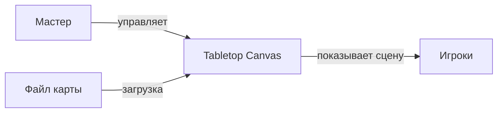
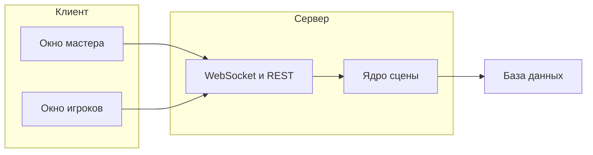
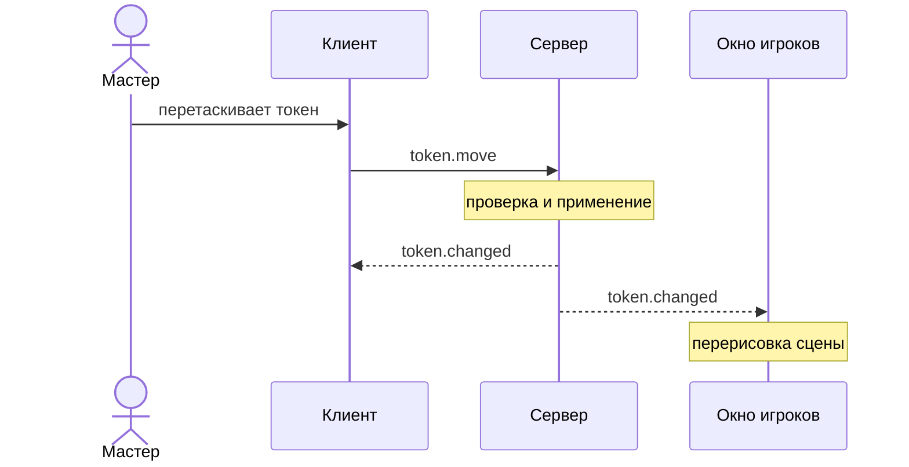
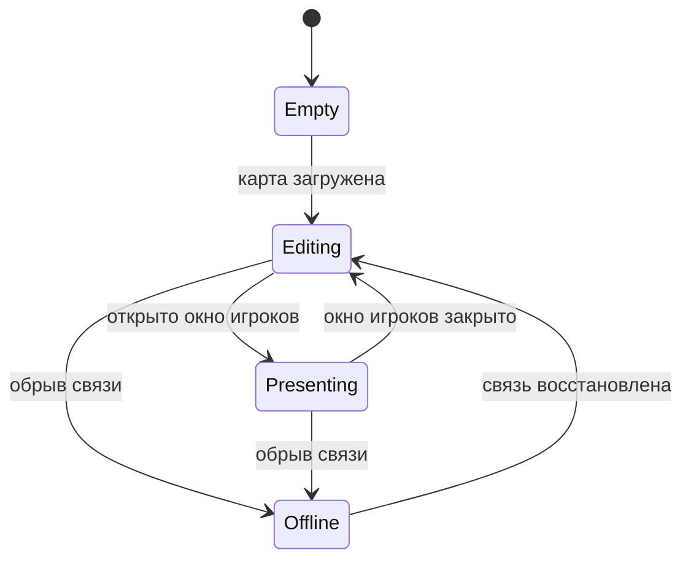

# Описание дизайна программного обеспечения

Для веб-приложения «Tabletop Canvas» (виртуальный стол для настольных ролевых игр)

Версия 0.1

Подготовил Белугин М.А., гр. 450501

БГУИР, кафедра электронных вычислительных машин

13.11.2026

## Оглавление

<!-- TOC -->
* [1. Введение](#1-introduction)
    * [1.1 Назначение документа](#11-document-purpose)
    * [1.2 Область применения](#12-subject-scope)
    * [1.3 Определения, акронимы и сокращения](#13-definitions-acronyms-and-abbreviations)
    * [1.4 Ссылки](#14-references)
    * [1.5 Обзор документа](#15-document-overview)
* [2. Обзор дизайна](#2-design-overview)
    * [2.1 Задачи стейкхолдеров](#21-stakeholder-concerns)
    * [2.2 Выбранные точки зрения](#22-selected-viewpoints)
        * [2.2.1 Контекст](#221-context)
        * [2.2.2 Композиция](#222-composition)
        * [2.2.3 Логическое представление](#223-logical)
        * [2.2.4 Физическое представление](#224-physical)
        * [2.2.5 Структура](#225-structure)
        * [2.2.6 Зависимости](#226-dependency)
        * [2.2.7 Информация](#227-information)
        * [2.2.8 Интерфейс](#228-interface)
        * [2.2.9 Взаимодействие](#229-interaction)
        * [2.2.10 Алгоритм](#2210-algorithm)
        * [2.2.11 Динамика состояний](#2211-state-dynamics)
        * [2.2.12 Параллелизм](#2212-concurrency)
        * [2.2.13 Паттерны](#2213-patterns)
        * [2.2.14 Развёртывание](#2214-deployment)
        * [2.2.15 Ресурсы](#2215-resources)
* [3. Проектные представления](#3-design-views)
* [4. Решения](#4-decisions)
* [5. Приложения](#5-appendixes)
<!-- TOC -->

## История изменений

| Name | Date | Reason For Changes | Version |
|------|------|--------------------|---------|
| М.А. Белугин | 13.11.2026 | Первая редакция по SRS v0.1 | 0.1 |

---

## 1. Введение {#1-introduction}

Документ описывает проектное решение для веб-приложения «Tabletop Canvas»: из каких частей оно состоит, как они взаимодействуют, какие данные хранятся и какие алгоритмы используются. Каждое проектное представление связано с требованиями SRS, которые оно реализует, и с решениями из раздела 4.

### 1.1 Назначение документа {#11-document-purpose}

SDD отвечает на вопрос, **как** будет реализовано то, что в SRS v0.1 определено как «что». Документ предназначен для разработчика (реализация по готовому проекту), тестировщика (проверяемые контракты и точки проверки), Заказчика (понимание принятых решений и их последствий) и преподавателя (трассируемость от требований к дизайну). Документ используется после согласования SRS и обновляется при каждом изменении требований. Связанный документ: SRS (`srs.md`).

### 1.2 Область применения {#12-subject-scope}

**Система:** «Tabletop Canvas», версия 0.1 — веб-приложение, которое заменяет мастеру настольной ролевой игры бумажную карту, фигурки и кубики. Мастер загружает изображение карты, накладывает сетку, расставляет токены, закрывает карту туманом войны и бросает кубики. Для игроков открывается отдельное окно, где видно только открытое мастером. Клиентская часть работает в браузере (React/TypeScript, Canvas 2D), серверная часть на Java 21 (Spring Boot) хранит сцены, вычисляет броски и синхронизирует два окна через WebSocket.

**Входит в SDD:** клиент, сервер, хранение сцен, обмен сообщениями между окнами и сервером, развёртывание в Docker.

**Не входит в SDD:** визуальный дизайн экранов и макеты, настройка сборки и CI, подробные тест-кейсы (раздел 4 SRS). Игра между разными компьютерами через интернет и учётные записи не проектируются.

Соответствие бизнес-целям SRS: BG-1 (подготовка сцены без бумаги) — представления 002, 003, 012; BG-2 (управление видимостью) — 009, 012; BG-3 (быстрые броски) — 011; BG-4 (независимость от правил игры) — 003, 011; BG-5 (повторное использование сцены) — 007, 013.

### 1.3 Определения, акронимы и сокращения {#13-definitions-acronyms-and-abbreviations}

| Term | Definition |
|------|------------|
| ADR | Architecture Decision Record — протокол архитектурного решения |
| API | Application Programming Interface — набор определений и протоколов для создания и интеграции прикладного ПО |
| Canvas 2D | Браузерный интерфейс двумерной отрисовки на холсте |
| JSON | JavaScript Object Notation — текстовый формат обмена данными |
| REST | Стиль построения веб-интерфейсов поверх HTTP |
| SDD | Software Design Document — документ, описывающий дизайн ПО |
| SRS | Software Requirements Specification — спецификация требований к ПО |
| WebSocket | Протокол двусторонней связи между браузером и сервером в реальном времени |
| Журнал бросков | Список последних 100 результатов бросков кубиков |
| Команда | Объект, описывающий одно изменение сцены и способ его отмены |
| Нотация кубиков | Запись вида NdM±K: N кубиков с M гранями и модификатор K |
| Окно игроков | Второе окно браузера, которое показывает сцену в режиме показа |
| Сцена | Карта вместе с сеткой, токенами и состоянием тумана |
| Токен | Графический маркер персонажа или монстра на карте |
| Туман войны | Слой, скрывающий ещё не исследованные клетки карты |

### 1.4 Ссылки {#14-references}

| № | Источник | Тип | Расположение |
|---|----------|-----|--------------|
| 1 | SRS «Tabletop Canvas», версия 0.1 | Нормативная | `srs.md` |
| 2 | Шаблон SDD | Справочная | `sdd-template.md` |
| 3 | RFC 6455: The WebSocket Protocol | Нормативная | https://www.rfc-editor.org/rfc/rfc6455 |
| 4 | RFC 8259: The JSON Data Interchange Format | Нормативная | https://www.rfc-editor.org/rfc/rfc8259 |
| 5 | Документация Spring Boot | Справочная | https://docs.spring.io/spring-boot/ |
| 6 | MDN: Canvas API | Справочная | https://developer.mozilla.org/docs/Web/API/Canvas_API |

### 1.5 Обзор документа {#15-document-overview}

Раздел 2 определяет стейкхолдеров и выбранные точки зрения. Раздел 3 содержит проектные представления с идентификаторами вида `001-context`; у каждого указаны точка зрения, представление (текст, таблица или небольшая диаграмма) и связанные требования SRS и решения. В разделе 4 перечислены архитектурные решения. Раздел 5 содержит трассировку «требование → представление» (приложение A) и точки расширения (приложение B). Диаграммы записаны в нотации Mermaid и отображаются на GitHub; их немного и они намеренно небольшие. Изменения фиксируются в истории изменений.

---

## 2. Обзор дизайна {#2-design-overview}

Приложение построено как клиент-серверное. Клиент (React/TypeScript, Canvas 2D) отвечает за отрисовку и ввод. Сервер (Java 21, Spring Boot) является источником истины: хранит сцену, проверяет действия, вычисляет броски и рассылает изменения двум окнам по WebSocket. Окно мастера и окно игроков — два экземпляра одного клиента с разными ролями. Ядро сервера (сцена и кубики) не зависит от Spring и базы данных, поэтому проверяется обычными модульными тестами.

### 2.1 Задачи стейкхолдеров {#21-stakeholder-concerns}

| Стейкхолдер | Основные задачи | Точки зрения и представления |
|-------------|-----------------|------------------------------|
| Мастер игры | Быстро подготовить сцену, плавная работа с картой, не потерять данные | Алгоритм (011, 012), Динамика состояний (013), Интерфейс (008, 018), Информация (007) |
| Игрок | Видеть только открытое мастером, чёткая картинка | Взаимодействие (009), Алгоритм (012) |
| Заказчик | Соответствие SRS, понятность решений | Контекст (001), Решения (раздел 4), Приложение A |
| Разработчик | Понятная структура, независимое ядро, возможность расширения | Композиция (002), Логическое (003), Зависимости (006), Паттерны (015) |
| Тестировщик | Проверяемые контракты, воспроизводимые броски и состояния | Интерфейс (008), Алгоритм (011), Динамика состояний (013) |
| Преподаватель | Трассируемость требований, обоснованность решений | Приложение A, раздел 4 |

### 2.2 Выбранные точки зрения {#22-selected-viewpoints}

Выбраны все 15 точек зрения шаблона. Для небольшого приложения большинство из них описано кратко текстом или таблицей; диаграммы использованы только там, где они проясняют решение (представления 001, 002, 009 и 013).

#### 2.2.1 Контекст {#221-context}

Показывает приложение как «чёрный ящик»: мастер, игроки и файл карты. Адресует границы системы. Применено в **001-context**.

#### 2.2.2 Композиция {#222-composition}

Описывает деление на клиент, сервер и базу данных. Адресует распределение ответственности и модульность (REQ-CON-012). Применено в **002-composition**.

#### 2.2.3 Логическое представление {#223-logical}

Фиксирует основные типы предметной области: сцена, токен, туман, выражение кубиков, запись журнала. Применено в **003-logical**.

#### 2.2.4 Физическое представление {#224-physical}

Описывает физическое окружение: один компьютер, общий экран или проектор. Применено в **004-physical**.

#### 2.2.5 Структура {#225-structure}

Показывает внутреннее устройство клиента и сервера по модулям. Применено в **005-structure**.

#### 2.2.6 Зависимости {#226-dependency}

Фиксирует допустимое направление зависимостей между пакетами. Адресует независимость ядра (REQ-CON-012). Применено в **006-dependency**.

#### 2.2.7 Информация {#227-information}

Описывает постоянные данные: таблицы базы и формат JSON сцены. Применено в **007-information**.

#### 2.2.8 Интерфейс {#228-interface}

Специфицирует REST-запросы и сообщения WebSocket между клиентом и сервером. Применено в **008-interface**.

#### 2.2.9 Взаимодействие {#229-interaction}

Показывает порядок сообщений при перемещении токена и поведение при сбоях. Применено в **009-interaction-token** и **010-interaction-failures**.

#### 2.2.10 Алгоритм {#2210-algorithm}

Детализирует разбор и вычисление броска, привязку токена к клетке и работу с туманом. Применено в **011-algorithm-dice** и **012-algorithm-fog-snap**.

#### 2.2.11 Динамика состояний {#2211-state-dynamics}

Описывает состояния сессии и переходы между ними. Применено в **013-state-dynamics**.

#### 2.2.12 Параллелизм {#2212-concurrency}

Описывает порядок обработки команд, ограничение частоты сообщений и переподключение. Применено в **014-concurrency**.

#### 2.2.13 Паттерны {#2213-patterns}

Фиксирует применённые паттерны и места их применения. Применено в **015-patterns**.

#### 2.2.14 Развёртывание {#2214-deployment}

Описывает запуск в Docker и размещение данных. Применено в **016-deployment**.

#### 2.2.15 Ресурсы {#2215-resources}

Описывает ограничения на размер карты, память и частоту сообщений. Применено в **017-resources**.

---

## 3. Проектные представления {#3-design-views}

Идентификаторы вида `ННН-название` используются для ссылок из других разделов. В каждом представлении указаны реализуемые требования SRS (REQ-…) и связанные решения (ADR-…).

### 001-context — Контекст системы

- **ID**: 001-context
- **Title**: Контекст приложения «Tabletop Canvas»
- **Viewpoint**: Контекст
- **Representation**:



Приложение предоставляет мастеру загрузку карты, сетку, токены, туман войны, кубики, сохранение сцены и отмену действий. Игроки только смотрят окно игроков и сообщают мастеру свои действия. Внешних сервисов нет.

- **More Information**: SRS 2.1, 2.2; REQ-FUNC-001, REQ-SEC-011.

### 002-composition — Состав приложения

- **ID**: 002-composition
- **Title**: Композиция приложения из клиента, сервера и базы данных
- **Viewpoint**: Композиция
- **Representation**:



Функциональное деление: карта и сетка, токены, туман войны, кубики, сохранение сцены. Рантайм-деление: два окна браузера и один процесс сервера; клиентская часть раздаётся тем же сервером как набор статических файлов.

- **More Information**: REQ-CON-012; решения: ADR-001, ADR-002.

### 003-logical — Типы предметной области

- **ID**: 003-logical
- **Title**: Логическая модель: основные типы
- **Viewpoint**: Логическое представление
- **Representation**:

| Тип | Назначение | Основные поля |
|-----|------------|---------------|
| `Scene` | Сцена целиком | `name`, `mapId`, `cellSize` (20–200 px), `gridVisible`, `tokens`, `fog` |
| `MapImage` | Изображение карты | `id`, `mime` (PNG, JPEG, WebP), `width`, `height`, `content` |
| `Token` | Маркер на карте | `id`, `name` (до 40 символов), `color`, `size` (1–4 клетки), `col`, `row`, `hidden` |
| `FogMask` | Состояние тумана по клеткам | `enabled`, `cols`, `rows`, `open` (битовая маска открытых клеток) |
| `DiceExpression` | Разобранная запись броска | `count` (1–50), `sides` (2–1000), `modifier` (−1000…1000) |
| `RollEntry` | Запись журнала | `text`, `values`, `modifier`, `total`, `hidden`, `time` |
| `Command` | Изменение сцены с обратным действием | `apply()`, `revert()` |

Все типы ядра — обычные классы Java без зависимостей от Spring и базы данных. Состояние тумана хранится по клеткам сетки, поэтому размер маски зависит только от числа клеток.

- **More Information**: REQ-FUNC-001 … REQ-FUNC-008, REQ-CON-012.

### 004-physical — Физическое окружение

- **ID**: 004-physical
- **Title**: Физическое окружение приложения
- **Viewpoint**: Физическое представление
- **Representation**: Всё выполняется на одном компьютере мастера под управлением Windows, Linux или macOS. К компьютеру подключён общий экран (второй монитор, проектор или телевизор), на который выводится окно игроков. Интернет не нужен: сервер и браузер работают на одном компьютере (`localhost`). Другого оборудования нет.
- **More Information**: SRS 2.5, REQ-CON-012.

### 005-structure — Внутреннее устройство

- **ID**: 005-structure
- **Title**: Модули клиента и сервера
- **Viewpoint**: Структура
- **Representation**:

| Часть | Модуль | Ответственность |
|-------|--------|-----------------|
| Клиент | `renderer` | Отрисовка карты, сетки, тумана и токенов на Canvas 2D |
| Клиент | `input` | Мышь и горячие клавиши, перевод действий в команды |
| Клиент | `store` | Текущее состояние сцены, стек отмены и повтора |
| Клиент | `connection` | WebSocket, переподключение, REST-запросы |
| Сервер | `web` | REST-контроллеры и обработчик WebSocket |
| Сервер | `session` | Две аудитории сообщений (мастер и игроки), рассылка |
| Сервер | `core` | Сцена, проверка команд, кубики (без Spring) |
| Сервер | `storage` | Репозиторий сцен и карт |

- **More Information**: REQ-CON-012; решение: ADR-003.

### 006-dependency — Зависимости между пакетами

- **ID**: 006-dependency
- **Title**: Допустимые зависимости
- **Viewpoint**: Зависимости
- **Representation**:

| Пакет | Может зависеть от | Не должен зависеть от |
|-------|-------------------|-----------------------|
| `web` | `session`, `core` | `storage` напрямую |
| `session` | `core` | `web`, `storage` |
| `storage` | `core` (интерфейс репозитория) | `web`, `session` |
| `core` | только стандартная библиотека Java | Spring Web, WebSocket, JDBC, JPA |

Зависимости направлены от инфраструктуры к ядру. Интерфейс `SceneRepository` объявлен в `core`, а реализация находится в `storage`, поэтому ядро проверяется тестами без запуска Spring.

- **More Information**: REQ-CON-012.

### 007-information — Постоянные данные

- **ID**: 007-information
- **Title**: Структура сохраняемых данных
- **Viewpoint**: Информация
- **Representation**: Данные хранятся в базе H2 (файл на томе Docker), кодировка UTF-8.

| Таблица | Поля | Правила |
|---------|------|---------|
| `scene` | `id`, `name`, `schema_version`, `data` (JSON), `map_id`, `autosave` (признак), `updated_at` | Одна запись автосохранения на сервер; при записи структура и версия проверяются |
| `map_image` | `id`, `mime`, `width`, `height`, `content` (BLOB) | Не более 20 МБ и 8192 px по большей стороне |

Пример поля `data` (сокращённо):

```json
{
  "schemaVersion": 1,
  "name": "Подземелье",
  "mapId": "7c1e9a52",
  "grid": { "cellSize": 50, "visible": true },
  "tokens": [
    { "id": "t1", "name": "Гном", "color": "#c0392b", "size": 1, "col": 4, "row": 7, "hidden": false }
  ],
  "fog": { "enabled": true, "cols": 80, "rows": 60, "open": "AAAA" }
}
```

Журнал бросков в сцену не входит. Изображение карты хранится отдельно от JSON, чтобы запись сцены оставалась небольшой, а при автосохранении карта не копировалась.

- **More Information**: REQ-FUNC-001, REQ-FUNC-007; решение: ADR-001.

### 008-interface — Контракты интерфейсов

- **ID**: 008-interface
- **Title**: REST-запросы и сообщения WebSocket
- **Viewpoint**: Интерфейс
- **Representation**:

REST (формат ошибок — `{ "error": "код", "message": "текст" }`):

| Запрос | Назначение | Ответы |
|--------|------------|--------|
| `POST /api/maps` | Загрузить карту (multipart) | 201 с `id`; 415 неверный тип; 413 слишком большой файл; 400 больше 8192 px |
| `GET /api/maps/{id}` | Получить изображение карты | 200; 404 |
| `GET /api/scenes` | Список сцен | 200 |
| `POST /api/scenes` | Сохранить новую сцену | 201; 400 неверная структура или версия |
| `GET /api/scenes/{id}` | Получить сцену | 200; 404 |
| `PUT /api/scenes/{id}` | Заменить сцену | 200; 400; 404 |
| `PUT /api/scenes/autosave` | Записать автосохранение | 204 |
| `GET /api/scenes/autosave` | Получить автосохранение | 200; 404 |

WebSocket `/ws?role=master` или `/ws?role=players`. Каждое сообщение — JSON `{ "type": ..., "seq": ..., "payload": ... }`:

| Сообщение | Направление | Содержимое |
|-----------|-------------|------------|
| `scene.state` | сервер → клиент | Полное состояние сцены для своей аудитории; отправляется при подключении и переподключении |
| `token.add`, `token.update`, `token.move`, `token.remove` | мастер → сервер | Изменение токена; сервер проверяет границы карты и рассылает `token.changed` |
| `fog.apply` | мастер → сервер | Форма (`brush`, `rect`, `all`), режим (`open`, `close`) и клетки |
| `view.set` | мастер → сервер | Масштаб и положение карты для окна игроков |
| `dice.roll` | мастер → сервер | Кнопка кубика или запись NdM±K, признак `hidden` |
| `dice.result` | сервер → клиент | Запись журнала; скрытый бросок получает только мастер |
| `error` | сервер → клиент | Код и текст ошибки |

Скрытые токены и скрытые броски в аудиторию игроков не отправляются.

- **More Information**: REQ-FUNC-001, REQ-FUNC-003 … REQ-FUNC-007, REQ-SEC-011; решения: ADR-001, ADR-002.

### 009-interaction-token — Перемещение токена

- **ID**: 009-interaction-token
- **Title**: Сценарий «счастливого пути»: мастер перемещает токен
- **Viewpoint**: Взаимодействие
- **Representation**:



Во время перетаскивания клиент перерисовывает токен сразу, не дожидаясь сервера; на сервер отправляется не более 30 сообщений в секунду и итоговое положение при отпускании. Окно игроков получает изменение не позднее чем через 200 мс.

- **More Information**: REQ-FUNC-003, REQ-FUNC-005, REQ-PERF-009.

### 010-interaction-failures — Пути отказа

- **ID**: 010-interaction-failures
- **Title**: Поведение при сбоях
- **Viewpoint**: Взаимодействие
- **Representation**:

| Ситуация | Поведение | Требования |
|----------|-----------|------------|
| Неподходящий файл карты (тип, размер, разрешение) | Сообщение с причиной; текущая карта не меняется | REQ-FUNC-001 |
| Неправильная запись кубиков | Сообщение об ошибке; журнал не меняется | REQ-FUNC-006 |
| Токен перетащен за границу карты | Токен останавливается у края | REQ-FUNC-003 |
| Повреждённый или несовместимый JSON сцены | Сообщение; текущая сцена не меняется; приложение продолжает работать | REQ-FUNC-007, REQ-REL-010 |
| Обрыв WebSocket | Предупреждение, автоматическое переподключение, после него приходит `scene.state` | REQ-REL-010 |
| Окно игроков закрыто и открыто повторно | Сервер отправляет текущее состояние сцены | REQ-REL-010 |
| Закрытие вкладки с несохранёнными изменениями | Предупреждение браузера | REQ-FUNC-008 |

- **More Information**: диаграмма 013-state-dynamics.

### 011-algorithm-dice — Вычисление броска

- **ID**: 011-algorithm-dice
- **Title**: Разбор записи кубиков и вычисление результата
- **Viewpoint**: Алгоритм
- **Representation**:

```text
Roll(text, hidden):
  text = убрать пробелы, привести к нижнему регистру
  разобрать по шаблону  ^(\d{1,2})?d(\d{1,4})([+-]\d{1,4})?$
  не совпало -> ошибка INVALID_EXPRESSION
  count = первая группа или 1;  sides = вторая;  modifier = третья или 0
  если count не в 1..50, или sides не в 2..1000, или modifier не в -1000..1000
      -> ошибка OUT_OF_RANGE
  values = count раз: random.nextInt(1, sides + 1)     // SecureRandom
  total = sum(values) + modifier
  добавить запись в журнал; если записей больше 100, удалить самую старую
  вернуть запись (скрытую — только мастеру)
```

Кнопки d4, d6, d8, d10, d12, d20 и d100 вызывают тот же алгоритм с готовой записью `1dM`. Примеры: `2d6+3` даёт значения от 5 до 15, `1d20-1` — от 0 до 19; записи `d`, `0d6`, `2d1`, `51d6`, `abc` отвергаются. Сложность — O(count), то есть не более 50 случайных чисел на бросок.

- **More Information**: REQ-FUNC-006.

### 012-algorithm-fog-snap — Привязка токена и туман

- **ID**: 012-algorithm-fog-snap
- **Title**: Привязка токена к клетке и операции с туманом
- **Viewpoint**: Алгоритм
- **Representation**:

**Привязка токена.** По координатам отпускания `(x, y)` на карте: `col = floor(x / cellSize)`, `row = floor(y / cellSize)`. Для токена размером `s` клеток значения ограничиваются диапазонами `0 … cols − s` и `0 … rows − s`, поэтому токен не выходит за границу карты.

**Туман.** Состояние — битовая маска клеток (`1` — клетка открыта). Операции:

| Операция | Действие над маской |
|----------|---------------------|
| Кисть радиуса `r` (1–10) | Клетки, для которых `dx² + dy² ≤ r²` от центра кисти, открываются или закрываются |
| Прямоугольник | Все клетки внутри прямоугольника |
| «Открыть всё» и «Закрыть всё» | Вся маска |

**Отрисовка кадра** (по слоям): карта, сетка, токены, туман. В окне игроков закрытые клетки закрашиваются сплошным цветом без прозрачности, а скрытые токены не приходят с сервера. В окне мастера туман рисуется с прозрачностью около 50 %. Слой тумана хранится на отдельном холсте и обновляется только для изменённых клеток, а декодированное изображение карты сохраняется один раз (`createImageBitmap`), поэтому перерисовка кадра сводится к нескольким вызовам `drawImage`.

- **More Information**: REQ-FUNC-002 … REQ-FUNC-005, REQ-PERF-009; решение: ADR-003.

### 013-state-dynamics — Состояния сессии

- **ID**: 013-state-dynamics
- **Title**: Конечный автомат сессии мастера
- **Viewpoint**: Динамика состояний
- **Representation**:



| Состояние | Описание |
|-----------|----------|
| `Empty` | Карта не загружена; доступны загрузка карты и открытие сцены |
| `Editing` | Мастер расставляет токены, управляет туманом, бросает кубики |
| `Presenting` | Открыто окно игроков, изменения синхронизируются |
| `Offline` | Нет связи с сервером; показывается предупреждение, клиент переподключается |

Сохранение и автосохранение состояние не меняют. После восстановления связи клиент получает `scene.state` и продолжает работу в состоянии `Editing`.

- **More Information**: REQ-FUNC-005, REQ-FUNC-007, REQ-REL-010.

### 014-concurrency — Параллелизм и синхронизация

- **ID**: 014-concurrency
- **Title**: Порядок обработки команд и переподключение
- **Viewpoint**: Параллелизм
- **Representation**:

| Задача | Механизм | Требования |
|--------|----------|------------|
| Порядок изменений сцены | Все команды одной сцены обрабатываются последовательно (блокировка на сцену); результат рассылается после применения | REQ-FUNC-005 |
| Нагрузка при перетаскивании | Клиент отправляет не более 30 сообщений `token.move` в секунду и итоговое положение | REQ-FUNC-005, REQ-PERF-009 |
| Потеря сообщений | У каждого сообщения есть номер `seq`; при разрыве нумерации клиент запрашивает полное `scene.state` | REQ-REL-010 |
| Переподключение | Повтор с растущей паузой (1, 2, 4 … до 10 секунд), после подключения приходит `scene.state` | REQ-REL-010 |
| Автосохранение | Таймер на клиенте раз в 30 секунд, запрос отправляется только при наличии изменений | REQ-FUNC-007 |
| Отрисовка | Цикл `requestAnimationFrame`; кадр перерисовывается только при изменении состояния | REQ-PERF-009 |

- **More Information**: решение ADR-002; диаграмма 009-interaction-token.

### 015-patterns — Применённые паттерны

- **ID**: 015-patterns
- **Title**: Паттерны проектирования
- **Viewpoint**: Паттерны
- **Representation**:

| Паттерн | Где применён | Зачем |
|---------|--------------|-------|
| Command | Изменения сцены (`Command.apply`, `Command.revert`) | Отмена и повтор 50 действий; одинаковая обработка на клиенте и сервере |
| Publish–Subscribe | `session`: аудитории «мастер» и «игроки» | Рассылка изменений и фильтрация скрытых данных |
| Repository | `SceneRepository` | Ядро не знает о базе данных |
| Слоистая архитектура | `web` → `session` → `core` ← `storage` | Независимость ядра (REQ-CON-012) |

- **More Information**: REQ-FUNC-008, REQ-CON-012; решение: ADR-004.

### 016-deployment — Развёртывание

- **ID**: 016-deployment
- **Title**: Запуск и размещение данных
- **Viewpoint**: Развёртывание
- **Representation**:

```text
docker compose up --build
  контейнер tabletop (Java 21, Spring Boot, порт 8080)
    - отдаёт собранный клиент (статические файлы)
    - принимает REST /api и WebSocket /ws
    - хранит базу H2 на томе data
```

Мастер открывает `http://localhost:8080`; кнопка «Окно игроков» открывает второе окно с `role=players`, его перетаскивают на общий экран. Content-Security-Policy разрешает соединения только на собственный адрес и `ws://localhost`, поэтому внешних запросов нет. Для разработки сервер можно запустить без Docker командой `./mvnw spring-boot:run`.

- **More Information**: REQ-CON-012, REQ-SEC-011.

### 017-resources — Ресурсы

- **ID**: 017-resources
- **Title**: Использование ограниченных ресурсов
- **Viewpoint**: Ресурсы
- **Representation**:

| Ресурс | Ограничение и стратегия | Требования |
|--------|-------------------------|------------|
| Размер карты | Не более 20 МБ и 8192 px; проверка на клиенте и на сервере | REQ-FUNC-001 |
| Память клиента | Декодированная карта 4096×4096 px занимает около 64 МБ; хранится один экземпляр на окно | REQ-PERF-009 |
| Частота сообщений | Не более 30 `token.move` в секунду; сообщения содержат только изменение, а не всю сцену | REQ-FUNC-005 |
| Журнал бросков | Не более 100 записей | REQ-FUNC-006 |
| Отмена и повтор | Не более 50 команд в стеке | REQ-FUNC-008 |
| Автосохранение | Одна запись; карта не копируется | REQ-FUNC-007 |
| Время отклика | Не менее 30 кадров в секунду; карта 5 МБ отображается не позднее чем через 2 с; синхронизация не более 200 мс | REQ-PERF-009, REQ-FUNC-005 |

- **More Information**: диаграммы 012 и 014.

### 018-ui-layout — Раскладка окон

- **ID**: 018-ui-layout
- **Title**: Состав окна мастера и окна игроков
- **Viewpoint**: Интерфейс (пользовательский)
- **Representation**:

| Окно | Состав |
|------|--------|
| Мастер | Панель инструментов (карта, сетка, масштаб, кубики, окно игроков), список токенов, инструменты тумана, рабочая область с картой, панель кубиков с журналом |
| Игроки | Только карта с открытыми областями и журнал открытых бросков; панелей и инструментов нет |

Горячие клавиши: `Del` — удалить выбранный токен, `Ctrl+Z` и `Ctrl+Y` — отмена и повтор, `Ctrl+S` — сохранить сцену, `F` — открыть окно игроков. В полях ввода клавиши не срабатывают. Имена токенов и записи журнала выводятся как обычный текст, без интерпретации HTML. Интерфейс на русском языке.

- **More Information**: REQ-FUNC-008, REQ-SEC-011, REQ-CON-012.

---

## 4. Решения {#4-decisions}

- **ID**: 001-h2-storage
- **Title**: Хранение сцен во встроенной базе H2, карты — отдельной таблицей
- **Context**: SRS требует хранить сцены на сервере (REQ-FUNC-007), запуск должен выполняться одной командой без установки СУБД (REQ-CON-012). Карта может весить до 20 МБ, а автосохранение происходит каждые 30 секунд.
- **Options**: H2 (файл на томе Docker); PostgreSQL в отдельном контейнере; файлы JSON на диске.
- **Outcome**: Выбран вариант «H2», потому что он не требует отдельного сервера и ставится вместе с приложением. Сцена хранится как JSON в одном поле, карта — в отдельной таблице, чтобы автосохранение не копировало изображение.
- **More Information**: SRS 2.1; представление 007.

---

- **ID**: 002-websocket-server-authority
- **Title**: Синхронизация окон через WebSocket, сервер — источник истины
- **Context**: Окно игроков должно получать изменения не позднее чем через 200 мс (REQ-FUNC-005), скрытые токены и броски не должны попадать к игрокам, а броски должны вычисляться на сервере (REQ-FUNC-006).
- **Options**: WebSocket с сервером как источником истины; периодический опрос по REST; обмен между окнами в браузере без сервера.
- **Outcome**: Выбран вариант «WebSocket с сервером как источником истины», потому что он даёт малую задержку, позволяет разделить аудитории «мастер» и «игроки» и восстановить состояние после обрыва связи отправкой `scene.state`.
- **More Information**: представления 008, 009, 014.

---

- **ID**: 003-canvas-2d-rendering
- **Title**: Отрисовка карты на Canvas 2D с отдельным слоем тумана
- **Context**: Нужно держать не менее 30 кадров в секунду на карте 4096×4096 px с 50 токенами и туманом (REQ-PERF-009).
- **Options**: Canvas 2D со слоями и кэшем; элементы DOM и CSS; WebGL.
- **Outcome**: Выбран вариант «Canvas 2D», потому что он указан в ограничениях SRS, достаточен для двумерной сцены и проще WebGL. Производительность обеспечивается однократным декодированием карты и обновлением слоя тумана только по изменённым клеткам.
- **More Information**: представления 005, 012, 017.

---

- **ID**: 004-client-undo-commands
- **Title**: Отмена и повтор через стек команд на клиенте
- **Context**: Нужно отменять и повторять до 50 действий (REQ-FUNC-008), при этом окно игроков должно сразу видеть результат.
- **Options**: Стек команд на клиенте, каждая отмена отправляется как обычное изменение; история изменений на сервере; снимки всей сцены.
- **Outcome**: Выбран вариант «Стек команд на клиенте», потому что отмена превращается в обычную команду, сервер и окно игроков обрабатывают её так же, как любое другое изменение, а снимки сцены не нужны.
- **More Information**: представления 003, 015.

---

## 5. Приложения {#5-appendixes}

### Приложение A. Трассировка «требование → представление»

| Требование SRS | Представления SDD | Решения |
|----------------|-------------------|---------|
| REQ-FUNC-001 (загрузка карты) | 007, 008, 010, 017 | ADR-001 |
| REQ-FUNC-002 (сетка, масштаб) | 003, 012, 018 | ADR-003 |
| REQ-FUNC-003 (токены) | 003, 008, 009, 012 | — |
| REQ-FUNC-004 (туман войны) | 003, 012 | ADR-003 |
| REQ-FUNC-005 (окно игроков) | 002, 008, 009, 014 | ADR-002 |
| REQ-FUNC-006 (кубики и журнал) | 008, 011 | ADR-002 |
| REQ-FUNC-007 (сохранение и загрузка) | 007, 008, 010, 014 | ADR-001 |
| REQ-FUNC-008 (отмена, горячие клавиши) | 003, 015, 018 | ADR-004 |
| REQ-PERF-009 (производительность) | 009, 012, 014, 017 | ADR-003 |
| REQ-REL-010 (устойчивость к сбоям) | 010, 013, 014 | ADR-002 |
| REQ-SEC-011 (безопасность данных) | 001, 016, 018 | — |
| REQ-CON-012 (платформа и запуск) | 002, 005, 006, 016 | ADR-001 |

### Приложение B. Точки расширения

| Расширение | Состояние | Где добавляется |
|------------|-----------|-----------------|
| Сетка шестиугольников (OQ-1) | Не планируется | Новая реализация расчёта клетки в `core` и отрисовки в `renderer` |
| Линейка и измерение расстояний (OQ-2) | Отложено | Новый инструмент в `input` и `renderer`, сервер не затрагивается |
| Игра с нескольких устройств (OQ-4) | Не планируется | Адрес сервера вместо `localhost` и аутентификация в `web`; ядро не меняется |
| Значки состояний на токенах (OQ-6) | Отложено | Новое поле в `Token`, версия схемы JSON увеличивается |
| Замена базы данных | Не планируется | Новая реализация `SceneRepository` в `storage` |
