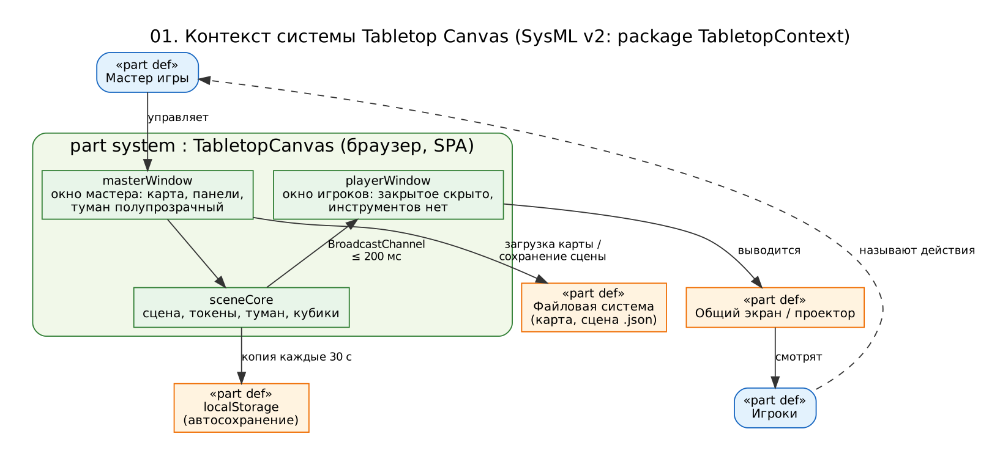
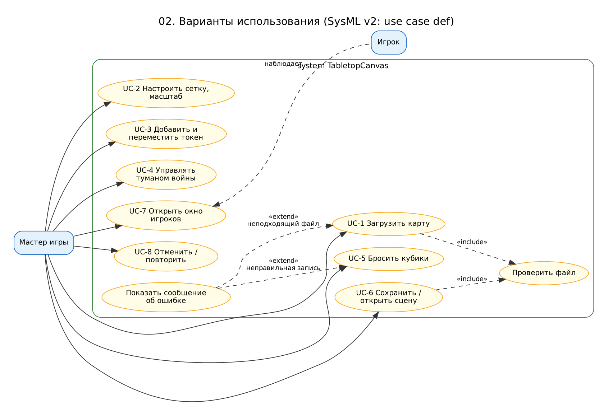
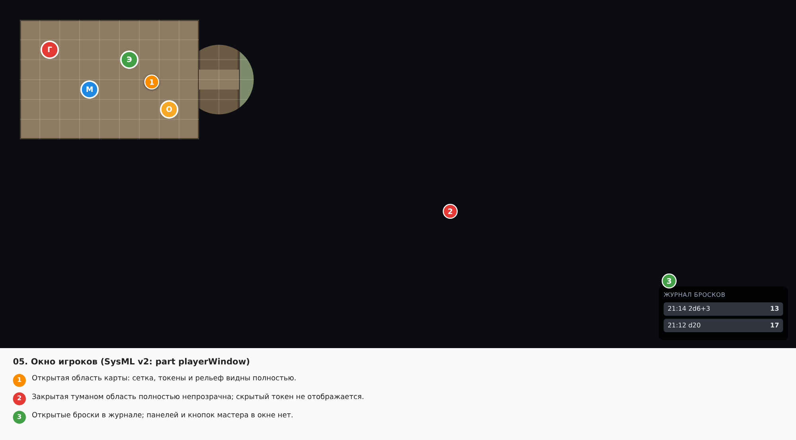
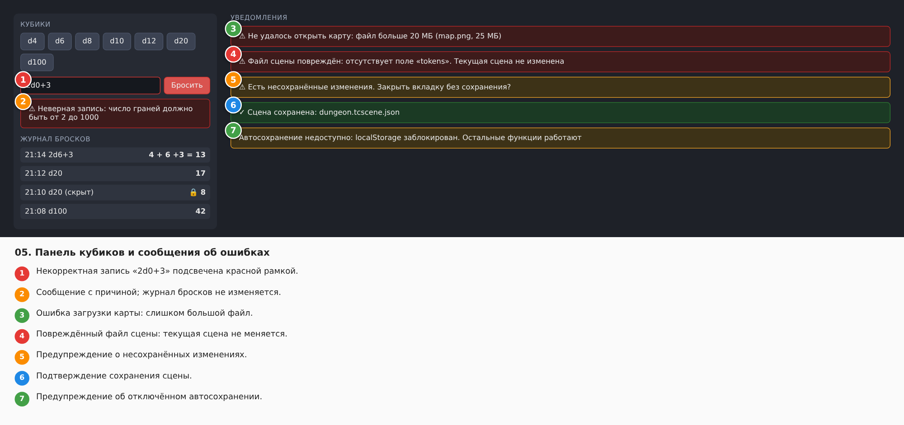

# Спецификация требований к ПО

Для веб-приложения «Tabletop Canvas» — виртуального стола для настольных ролевых игр

Версия 0.1

Подготовил Белугин Матвей Артемович, гр. 450501

БГУИР, кафедра электронных вычислительных машин

04.11.2026

## История изменений

| Name         | Date | Reason For Changes | Version |
|--------------|------|--------------------|---------|
| М.А. Белугин | 04.11.2026 | Первая редакция по бизнес-требованиям Заказчика | 0.1 |
|              |      |                    |         |

## 1. Введение

Документ описывает требования к веб-приложению «Tabletop Canvas» — виртуальному столу для настольных ролевых игр. Приложение содержит интерактивную карту, токены персонажей, туман войны и виртуальные кубики и заменяет мастеру игры бумажную карту, фигурки и ширму.

### 1.1 Назначение документа

SRS определяет, **что** должно делать приложение, а не **как** оно будет реализовано. Заказчик использует документ, чтобы подтвердить границы продукта и критерии приёмки; разработчик — как основу для проектирования, реализации и тестов. Каждое требование имеет уникальный идентификатор для трассировки к моделям и проверкам.

### 1.2 Область применения продукта

**Продукт:** «Tabletop Canvas», версия 0.1, одностраничное веб-приложение (SPA), работающее целиком в браузере.

**Назначение.** Мастер игры загружает изображение карты, накладывает сетку, расставляет и двигает токены, скрывает неисследованные области туманом войны и бросает кубики. Для игроков открывается отдельное окно (его выводят на второй монитор, проектор или телевизор), в котором видно только то, что мастер открыл.

**Бизнес-цели (источник: Заказчик):**

| ID | Бизнес-цель | Измеримый результат |
|----|-------------|---------------------|
| BO-1 | Мастер проводит партию без бумажной карты и фигурок | Карта с сеткой и токенами готова к игре менее чем за 5 минут |
| BO-2 | Мастер управляет информацией, доступной игрокам | В окне игроков закрытые туманом области и скрытые токены не видны |
| BO-3 | Броски кубиков быстрые и прозрачные для стола | Запись вида 2d6+3 вычисляется одним действием, результат фиксируется в журнале |
| BO-4 | Приложение подходит для разных игровых систем | В приложении нет правил конкретной игры; кубики и токены универсальны |
| BO-5 | Подготовленную сцену можно использовать повторно | Сцена сохраняется в файл и открывается без потери карты, токенов и тумана |

**Входит в область:** загрузка изображения карты, сетка, масштабирование и панорамирование, токены, туман войны, окно игроков с синхронизацией, бросок кубиков и журнал бросков, сохранение и загрузка сцены, отмена и повтор действий.

**Не входит в область:** сетевая игра через интернет, учётные записи, голосовая и видеосвязь, чат, листы персонажей, автоматический расчёт правил игры, динамическое освещение и линия обзора, анимация токенов, мобильные приложения.

### 1.3 Определения, акронимы и сокращения

| Term | Definition |
|------|------------|
| BroadcastChannel | Браузерный механизм обмена сообщениями между окнами одного источника |
| Canvas | HTML-элемент для программной отрисовки 2D-графики |
| SPA | Single Page Application — одностраничное веб-приложение |
| SRS | Software Requirements Specification — спецификация требований к ПО |
| SysML v2 | Systems Modeling Language версии 2 — язык моделирования для графической части |
| TBD | To Be Determined — значение ещё не согласовано с Заказчиком |
| UI | User Interface — пользовательский интерфейс |
| VTT | Virtual Tabletop — виртуальный стол для настольных игр |
| Игрок | Участник партии; видит только окно игроков и сообщает мастеру свои действия |
| Мастер игры (GM) | Ведущий партии; единственный пользователь, управляющий приложением |
| Нотация кубиков | Запись вида NdM±K: N кубиков с M гранями и модификатор K |
| Окно игроков | Второе окно браузера, отображающее сцену в режиме показа |
| Сетка | Равномерная разметка карты на клетки |
| Сцена | Карта вместе с сеткой, токенами и состоянием тумана |
| Токен | Графический маркер персонажа или монстра на карте |
| Туман войны | Слой, скрывающий ещё не исследованные области карты |

### 1.4 Ссылки

| № | Источник | Тип | Расположение |
|---|----------|-----|--------------|
| 1 | Источники и виды требований, ЖЦРПО Ч1 (СЭО БГУИР) | Справочная | СЭО БГУИР |
| 2 | MDN Web Docs: Canvas API, BroadcastChannel, File API | Справочная | https://developer.mozilla.org |
| 3 | RFC 8259 — The JSON Data Interchange Format | Нормативная | IETF |
| 4 | WCAG 2.1 — Web Content Accessibility Guidelines | Нормативная | https://www.w3.org/TR/WCAG21/ |
| 5 | OMG Systems Modeling Language (SysML) v2 | Справочная | https://www.omg.org/sysml/sysmlv2/ |
| 6 | Графические модели SysML v2 (исходники `.sysml` и PNG) | Нормативная | `diagrams/` |

### 1.5 Обзор документа

Раздел 2 даёт контекст продукта: перспективу, функции, ограничения, пользователей, допущения и распределение требований по итерациям. Раздел 3 содержит требования с идентификаторами, обоснованиями и критериями приёмки. Раздел 4 связывает требования с методами проверки. В приложениях собраны открытые вопросы к Заказчику и перечень графических моделей SysML v2.

---

## 2. Обзор продукта

### 2.1 Перспектива продукта

Приложение автономно: серверной части нет, данные не покидают компьютер пользователя. Мастер работает в основном окне, игроки смотрят на окно игроков, открытое на общем экране. Состояние сцены передаётся между окнами через BroadcastChannel. Файлы карт и сцен загружаются и сохраняются через файловую систему пользователя; промежуточная копия сцены хранится в localStorage.

*Рисунок 1 — контекст системы (SysML v2: `diagrams/01-context.sysml`).*

*Рисунок 2 — варианты использования (SysML v2: `diagrams/02-use-cases.sysml`).*

### 2.2 Функции продукта

- загрузка карты, управление сеткой, масштабом и положением карты;
- создание, перемещение, редактирование и скрытие токенов;
- управление туманом войны (открыть, закрыть, прямоугольник, «всё»);
- окно игроков, синхронизируемое с основным окном;
- бросок кубиков по нотации NdM±K и журнал бросков;
- сохранение и загрузка сцены, автосохранение, отмена и повтор

### 2.3 Ограничения продукта

- Язык разработки — TypeScript (strict), отрисовка — Canvas 2D API, сборка — Vite.
- Серверной части нет; внешние сервисы и платные библиотеки не используются.
- Поддерживаются актуальные версии Chrome, Firefox и Edge.
- Размер карты ограничен: PNG, JPEG или WebP, до 20 МБ и до 8192 px по большей стороне.
- Приложение не содержит правил конкретных игр и листов персонажей.

### 2.4 Характеристики пользователей

| Роль | Описание | Навыки и ожидания |
|------|----------|-------------------|
| Мастер игры | Готовит сцену, управляет туманом и токенами, бросает кубики | Уверенный пользователь ПК; ожидает быстрых действий мышью и горячих клавиш |
| Игрок | Смотрит на окно игроков и называет действия мастеру | Приложение не использует; ожидает чёткую картинку без служебных элементов |
| Разработчик | Дорабатывает и сопровождает приложение | Знает TypeScript; ожидает независимое ядро и тесты |

### 2.5 Допущения и зависимости

- Мастер использует один компьютер, к которому подключён общий экран или проектор.
- Окно игроков открывается в том же браузере и на том же источнике (origin), что и основное.
- Браузер разрешает всплывающие окна по действию пользователя.
- Размер localStorage достаточен для хранения сжатой копии сцены (до 5 МБ).

### 2.6 Распределение требований

| Цель | Описание | Требования |
|---|----------------------|----------------|
| C-1 | Приложение запускается в браузере без ошибок | REQ-INT-001, REQ-INT-002, REQ-REL-001, REQ-REL-002 |
| C-2 | Мастер загружает карту, включает сетку, масштабирует и двигает карту | REQ-FUNC-001 … REQ-FUNC-004, REQ-PERF-003 |
| C-3 | Токены добавляются и перемещаются мышью | REQ-FUNC-005 … REQ-FUNC-009 |
| C-4 | Туман войны скрывает карту от игроков | REQ-FUNC-010 … REQ-FUNC-015, REQ-PERF-002 |
| C-5 | Кубики и журнал бросков | REQ-FUNC-016 … REQ-FUNC-020, REQ-REUSE-001 |
| C-6 | Сохранение, загрузка и восстановление сцены | REQ-FUNC-021 … REQ-FUNC-025, REQ-REL-003 |

Распределение по итерациям:

| Итерация | Состав | Требования |
|----------|--------|------------|
| 1 (доказательство концепции) | Карта, токен и туман на двух окнах | REQ-POC-001 |
| 2 (ядро) | Модель сцены, туман, кубики, файл сцены | REQ-FUNC-005 … REQ-FUNC-022, REQ-SEC-*, REQ-REUSE-* |
| 3 (интерфейс) | Панели, горячие клавиши, окно игроков, отмена и повтор | REQ-INT-*, REQ-FUNC-001 … REQ-FUNC-004, REQ-FUNC-023 … REQ-FUNC-025 |
| 4 (качество) | Производительность, наблюдаемость, тесты, документация | REQ-PERF-*, REQ-OBS-*, REQ-MAINT-*, REQ-COMP-* |

Отложено: линия обзора и динамическое освещение, анимация перемещения токенов, сетевая синхронизация нескольких устройств (см. OQ-4), шаблоны областей (конус, круг).

---

## 3. Требования

Каждое требование содержит поля: **ID**, **Statement**, **Rationale**, **Acceptance Criteria**, **Verification Method** (Test, Analysis, Inspection, Demonstration). Источник по умолчанию — Заказчик; ссылки вида C-N указывают на таблицу в разделе 2.6.

### 3.1 Внешние интерфейсы

#### 3.1.1 Пользовательские интерфейсы

*Рисунок 3 — главное окно в режиме мастера.*

*Рисунок 4 — окно игроков.*

*Рисунок 5 — панель кубиков и сообщения об ошибках.*

**REQ-INT-001 — Поддерживаемые браузеры**
- **Statement:** Приложение должно запускаться и работать в актуальных версиях Chrome, Firefox и Edge.
- **Rationale:** Заказчик использует разные браузеры.
- **Acceptance Criteria:** Сценарии C-1…C-6 выполняются в трёх браузерах без ошибок в консоли.
- **Verification Method:** Demonstration

**REQ-INT-002 — Автономная работа**
- **Statement:** Приложение должно работать без серверной части и подключения к сети после загрузки статических файлов.
- **Rationale:** Игра проходит там, где нет интернета.
- **Acceptance Criteria:** При отключённой сети все функции из раздела 3.2 доступны.
- **Verification Method:** Test

**REQ-INT-003 — Размер экрана**
- **Statement:** Интерфейс должен корректно отображаться при разрешении окна от 1280×720 до 3840×2160 px.
- **Rationale:** Мастер работает на ноутбуке, игроки смотрят на 4K-телевизор.
- **Acceptance Criteria:** Панели не перекрывают друг друга, карта занимает всё оставшееся пространство.
- **Verification Method:** Demonstration

**REQ-INT-004 — Управление мышью**
- **Statement:** Основные действия (двигать токен, рисовать туман, панорамировать карту, масштабировать) должны выполняться мышью.
- **Rationale:** Мастер быстро управляет столом.
- **Acceptance Criteria:** Каждое действие из списка выполняется без клавиатуры.
- **Verification Method:** Test

**REQ-INT-005 — Горячие клавиши**
- **Statement:** Приложение должно поддерживать клавиши: Del — удалить токен, Ctrl+Z / Ctrl+Y — отмена и повтор, Ctrl+S — сохранить сцену, F — открыть окно игроков.
- **Rationale:** Ускорение работы мастера.
- **Acceptance Criteria:** Нажатие каждой клавиши вызывает указанное действие; в полях ввода клавиши не срабатывают.
- **Verification Method:** Test

**REQ-INT-006 — Русский интерфейс**
- **Statement:** Подписи интерфейса и сообщения об ошибках должны быть на русском языке.
- **Rationale:** Язык Заказчика.
- **Acceptance Criteria:** В интерфейсе нет подписей на других языках, кроме названий кубиков (d20).
- **Verification Method:** Inspection

### 3.2 Функциональные требования

**REQ-FUNC-001 — Загрузка карты**
- **Statement:** Система должна позволять загрузить изображение карты (PNG, JPEG, WebP) выбором файла или перетаскиванием в окно.
- **Rationale:** Основной источник карты — файл мастера (C-2).
- **Acceptance Criteria:** После выбора файла карта отображается в центре рабочей области целиком.
- **Verification Method:** Test

**REQ-FUNC-002 — Отклонение неподходящего файла**
- **Statement:** Система должна отклонять файлы другого типа, размером более 20 МБ или более 8192 px по большей стороне и показывать сообщение с причиной.
- **Rationale:** Защита от зависания и перегрузки памяти.
- **Acceptance Criteria:** Для файлов .gif, .pdf, 25 МБ и 10000×10000 px выводится сообщение; текущая карта не меняется.
- **Verification Method:** Test

**REQ-FUNC-003 — Сетка**
- **Statement:** Система должна накладывать на карту квадратную сетку с размером клетки от 20 до 200 px, включаемую и выключаемую мастером.
- **Rationale:** Токены и туман привязаны к клеткам.
- **Acceptance Criteria:** При изменении размера клетки сетка перерисовывается; выключенная сетка не отображается.
- **Verification Method:** Test

**REQ-FUNC-004 — Масштаб и панорамирование**
- **Statement:** Система должна позволять масштабировать карту колесом мыши в диапазоне 25–400 % и перемещать её перетаскиванием.
- **Rationale:** Работа с большими картами.
- **Acceptance Criteria:** Масштаб не выходит за границы диапазона; точка под курсором остаётся на месте при масштабировании.
- **Verification Method:** Test

**REQ-FUNC-005 — Добавление токена**
- **Statement:** Система должна позволять добавить токен с именем (до 40 символов), цветом и размером от 1×1 до 4×4 клеток.
- **Rationale:** Базовая функция стола (C-3).
- **Acceptance Criteria:** Новый токен появляется в центре видимой области и выбирается автоматически.
- **Verification Method:** Test

**REQ-FUNC-006 — Перемещение токена**
- **Statement:** Система должна позволять перетаскивать токен мышью и привязывать его к клетке сетки при отпускании.
- **Rationale:** Ключевой сценарий мастера.
- **Acceptance Criteria:** После отпускания центр токена совпадает с центром клетки; при выключенной сетке привязка не применяется.
- **Verification Method:** Test

**REQ-FUNC-007 — Границы карты**
- **Statement:** Система не должна позволять переместить токен за границы изображения карты.
- **Rationale:** Токен вне карты потерян для стола.
- **Acceptance Criteria:** При попытке выйти за границу токен останавливается у края.
- **Verification Method:** Test

**REQ-FUNC-008 — Редактирование и удаление токена**
- **Statement:** Система должна позволять изменить имя, цвет и размер токена и удалить его клавишей Del или через контекстное меню.
- **Rationale:** Токены меняются по ходу игры.
- **Acceptance Criteria:** Изменения отображаются сразу; удалённый токен исчезает из окна игроков.
- **Verification Method:** Test

**REQ-FUNC-009 — Скрытый токен**
- **Statement:** Система должна позволять пометить токен скрытым: в окне мастера он полупрозрачен, в окне игроков не отображается.
- **Rationale:** Засады и ещё не обнаруженные монстры.
- **Acceptance Criteria:** Скрытый токен отсутствует на экране игроков и виден мастеру.
- **Verification Method:** Test

**REQ-FUNC-010 — Включение тумана**
- **Statement:** Система должна позволять включить туман войны; при включении вся карта закрыта.
- **Rationale:** Исходное состояние перед исследованием.
- **Acceptance Criteria:** После включения в окне игроков карта полностью закрыта.
- **Verification Method:** Test

**REQ-FUNC-011 — Открытие и закрытие кистью**
- **Statement:** Система должна позволять открывать и закрывать области тумана кистью радиусом от 1 до 10 клеток.
- **Rationale:** Постепенное исследование подземелья.
- **Acceptance Criteria:** Мазок кисти открывает круг заданного радиуса; режим «закрыть» возвращает туман.
- **Verification Method:** Test

**REQ-FUNC-012 — Прямоугольная область и все клетки**
- **Statement:** Система должна позволять открывать и закрывать прямоугольную область, а также одной кнопкой открывать или закрывать всю карту.
- **Rationale:** Быстрое раскрытие комнат.
- **Acceptance Criteria:** Выбранный прямоугольник меняет состояние; кнопки «Открыть всё» и «Закрыть всё» применяются к целой карте.
- **Verification Method:** Test

**REQ-FUNC-013 — Режим мастера**
- **Statement:** В окне мастера туман должен отображаться полупрозрачным, чтобы мастер видел всю карту.
- **Rationale:** Мастер должен знать, что скрыто.
- **Acceptance Criteria:** Закрытые области в окне мастера видны с прозрачностью около 50 %.
- **Verification Method:** Demonstration

**REQ-FUNC-014 — Окно игроков**
- **Statement:** Система должна открывать отдельное окно игроков, где закрытые области полностью непрозрачны, а инструменты и скрытые токены не отображаются.
- **Rationale:** Игроки не должны видеть служебную информацию (BO-2).
- **Acceptance Criteria:** В окне игроков нет панелей; пиксели закрытых областей не содержат изображения карты.
- **Verification Method:** Test

**REQ-FUNC-015 — Синхронизация окон**
- **Statement:** Изменения сцены (карта, токены, туман, масштаб) должны автоматически отображаться в окне игроков.
- **Rationale:** Единая картина стола.
- **Acceptance Criteria:** Любое изменение в окне мастера появляется в окне игроков без ручного обновления.
- **Verification Method:** Test

**REQ-FUNC-016 — Бросок кубиков кнопкой**
- **Statement:** Система должна иметь кнопки для d4, d6, d8, d10, d12, d20 и d100, бросок выполняется одним нажатием.
- **Rationale:** Самые частые броски.
- **Acceptance Criteria:** Нажатие кнопки даёт целое число в диапазоне 1…M и добавляет запись в журнал.
- **Verification Method:** Test

**REQ-FUNC-017 — Нотация NdM±K**
- **Statement:** Система должна вычислять броски по записи NdM±K: N — от 1 до 50, M — от 2 до 1000, K — от −1000 до 1000.
- **Rationale:** Составные броски (2d6+3).
- **Acceptance Criteria:** Для «2d6+3» результат лежит в диапазоне 5…15; для «1d20-1» — в диапазоне 0…19.
- **Verification Method:** Test

**REQ-FUNC-018 — Неправильная запись**
- **Statement:** Система должна отвергать запись, не соответствующую нотации, и показывать сообщение с причиной, не изменяя журнал.
- **Rationale:** Опечатки неизбежны.
- **Acceptance Criteria:** Для «d», «0d6», «2d1», «51d6», «abc» выводится сообщение, журнал не меняется.
- **Verification Method:** Test

**REQ-FUNC-019 — Журнал бросков**
- **Statement:** Система должна вести журнал последних 100 бросков с записью, значениями кубиков, модификатором, суммой и временем.
- **Rationale:** Прозрачность результатов за столом.
- **Acceptance Criteria:** После 101-го броска первая запись удалена; журнал можно очистить кнопкой.
- **Verification Method:** Test

**REQ-FUNC-020 — Скрытый бросок**
- **Statement:** Система должна позволять выполнить бросок, который виден только мастеру и не отображается в окне игроков.
- **Rationale:** Тайные проверки мастера.
- **Acceptance Criteria:** Запись скрытого броска отсутствует в окне игроков и помечена в окне мастера.
- **Verification Method:** Test

**REQ-FUNC-021 — Сохранение сцены**
- **Statement:** Система должна сохранять сцену (изображение карты, размер клетки, токены, состояние тумана) в один файл JSON.
- **Rationale:** Повторное использование сцены (C-6).
- **Acceptance Criteria:** Файл создаётся по команде «Сохранить» и повторно открывается приложением без потерь.
- **Verification Method:** Test

**REQ-FUNC-022 — Загрузка сцены**
- **Statement:** Система должна загружать сцену из файла, проверяя структуру и версию формата; при ошибке текущая сцена не меняется.
- **Rationale:** Файлы могут быть повреждены или чужими.
- **Acceptance Criteria:** Корректный файл восстанавливает сцену; для повреждённого файла выводится сообщение, сцена не меняется.
- **Verification Method:** Test

**REQ-FUNC-023 — Автосохранение**
- **Statement:** Система должна каждые 30 секунд при наличии изменений сохранять копию сцены в localStorage и предлагать восстановить её при следующем запуске.
- **Rationale:** Защита от потери данных.
- **Acceptance Criteria:** После закрытия вкладки и повторного открытия предлагается восстановить последнюю копию.
- **Verification Method:** Test

**REQ-FUNC-024 — Предупреждение о несохранённых изменениях**
- **Statement:** Система должна предупреждать о несохранённых изменениях при закрытии вкладки или загрузке другой сцены.
- **Rationale:** Предотвращение потери работы.
- **Acceptance Criteria:** При изменениях после последнего сохранения появляется предупреждение браузера.
- **Verification Method:** Test

**REQ-FUNC-025 — Отмена и повтор**
- **Statement:** Система должна поддерживать отмену и повтор последних 50 действий над сценой (токены, туман, сетка).
- **Rationale:** Исправление ошибок мастера.
- **Acceptance Criteria:** Ctrl+Z возвращает предыдущее состояние, Ctrl+Y повторяет действие; журнал бросков отмене не подлежит.
- **Verification Method:** Test

### 3.3 Качество обслуживания

#### 3.3.1 Производительность

**REQ-PERF-001 — Плавность отрисовки**
- **Statement:** Приложение должно обеспечивать не менее 30 кадров в секунду при карте 4096×4096 px, 50 токенах и включённом тумане.
- **Rationale:** Работа без рывков при перетаскивании.
- **Acceptance Criteria:** Измеренная частота кадров при перетаскивании токена не ниже 30 FPS.
- **Verification Method:** Test

**REQ-PERF-002 — Задержка синхронизации**
- **Statement:** Изменение в окне мастера должно отображаться в окне игроков не позднее чем через 200 мс.
- **Rationale:** Игроки должны видеть актуальную картину.
- **Acceptance Criteria:** Для 50 токенов и тумана 95-й процентиль задержки не превышает 200 мс.
- **Verification Method:** Test

**REQ-PERF-003 — Загрузка карты**
- **Statement:** Карта размером 5 МБ должна отображаться не позднее чем через 2 секунды после выбора файла.
- **Rationale:** Быстрая подготовка сцены.
- **Acceptance Criteria:** Время от выбора файла до отрисовки не превышает 2 с.
- **Verification Method:** Test

#### 3.3.2 Безопасность

**REQ-SEC-001 — Отсутствие внешних запросов**
- **Statement:** Приложение не должно отправлять данные пользователя во внешние сети.
- **Rationale:** Карты и сцены могут быть приватными.
- **Acceptance Criteria:** Политика CSP запрещает внешние соединения (`connect-src 'none'`); в панели сети нет запросов при работе.
- **Verification Method:** Inspection

**REQ-SEC-002 — Безопасный вывод**
- **Statement:** Имена токенов и записи журнала должны выводиться как текст без интерпретации HTML.
- **Rationale:** Защита от внедрения скриптов через файл сцены.
- **Acceptance Criteria:** Имя `` отображается как обычный текст.
- **Verification Method:** Test

#### 3.3.3 Надёжность

**REQ-REL-001 — Повреждённый файл сцены**
- **Statement:** Повреждённый, неполный или несовместимый файл сцены не должен приводить к аварийному завершению приложения.
- **Rationale:** Файлы приходят от разных источников.
- **Acceptance Criteria:** Для 10 негативных файлов (пустой, не JSON, нет полей, неверные типы, неизвестная версия) выводится сообщение, приложение работает.
- **Verification Method:** Test

**REQ-REL-002 — Ошибки хранилища**
- **Statement:** При переполнении или недоступности localStorage приложение должно сообщить об этом и продолжить работу без автосохранения.
- **Rationale:** Хранилище может быть отключено в браузере.
- **Acceptance Criteria:** При блокировке localStorage появляется предупреждение; остальные функции доступны.
- **Verification Method:** Test

**REQ-REL-003 — Закрытие окна игроков**
- **Statement:** При закрытии и повторном открытии окна игроков оно должно получить актуальное состояние сцены.
- **Rationale:** Окно могут закрыть случайно.
- **Acceptance Criteria:** После повторного открытия окно показывает текущие карту, токены и туман.
- **Verification Method:** Test

#### 3.3.4 Доступность

Отдельных требований нет: приложение работает локально в браузере пользователя и не зависит от доступности серверов.

#### 3.3.5 Наблюдаемость

**REQ-OBS-001 — Журнал ошибок**
- **Statement:** Приложение должно записывать в консоль браузера ошибки и предупреждения с кодом, уровнем и описанием.
- **Rationale:** Диагностика проблем у пользователя.
- **Acceptance Criteria:** Для каждой ошибки из требований REQ-FUNC-002, 018, 022 в консоли есть запись с кодом.
- **Verification Method:** Inspection

### 3.4 Соответствие стандартам

**REQ-COMP-001 — Доступность интерфейса**
- **Statement:** Контраст текста и фона элементов управления должен быть не менее 4.5:1 (WCAG 2.1, критерий 1.4.3).
- **Rationale:** Читаемость при проекторе и слабом зрении.
- **Acceptance Criteria:** Проверка инструментом аудита не выявляет нарушений контраста.
- **Verification Method:** Inspection

**REQ-COMP-002 — Формат файла сцены**
- **Statement:** Файл сцены должен быть корректным JSON по RFC 8259 в кодировке UTF-8 и содержать поле версии схемы.
- **Rationale:** Совместимость и расширяемость.
- **Acceptance Criteria:** Файл разбирается стандартным JSON-парсером; поле `schemaVersion` присутствует.
- **Verification Method:** Test

**REQ-COMP-003 — Строгая типизация**
- **Statement:** Исходный код должен компилироваться TypeScript с включённым режимом `strict` без ошибок.
- **Rationale:** Снижение числа дефектов.
- **Acceptance Criteria:** Команда `tsc --noEmit` завершается без ошибок.
- **Verification Method:** Inspection

### 3.5 Проектирование и реализация

#### 3.5.1 Установка

Установка не требуется: приложение открывается в браузере из статической сборки (`index.html`) или с локального сервера разработки.

#### 3.5.2 Сборка и поставка

Сборка выполняется командой `npm run build`; результат — каталог статических файлов без серверной части.

#### 3.5.3 Распределение

Исходный код хранится в Git-репозитории; ветка с документами и ветка с кодом разделены, изменения вносятся через pull-request.

#### 3.5.4 Сопровождаемость

**REQ-MAINT-001 — Тестовое покрытие**
- **Statement:** Модульные тесты должны покрывать не менее 80 % строк ядра (сцена, туман, кубики, формат файла).
- **Rationale:** Безопасные изменения.
- **Acceptance Criteria:** Отчёт покрытия показывает не менее 80 %.
- **Verification Method:** Analysis

**REQ-MAINT-002 — Независимость ядра**
- **Statement:** Ядро не должно использовать DOM, Canvas и BroadcastChannel.
- **Rationale:** Тесты без браузера.
- **Acceptance Criteria:** Импорты каталога `core/` не содержат браузерных API; тесты запускаются в Node.js.
- **Verification Method:** Inspection

#### 3.5.5 Повторное использование

**REQ-REUSE-001 — Модуль кубиков**
- **Statement:** Разбор и вычисление нотации кубиков должны быть выделены в независимый модуль с генератором случайных чисел, подставляемым снаружи.
- **Rationale:** Повторное использование и детерминированные тесты.
- **Acceptance Criteria:** Тесты подставляют фиксированный генератор и получают предсказуемые результаты.
- **Verification Method:** Test

**REQ-REUSE-002 — Нейтральность к играм**
- **Statement:** В приложении не должно быть правил, терминов и справочников конкретной игровой системы.
- **Rationale:** Приложение подходит для разных игр (BO-4).
- **Acceptance Criteria:** Поиск по коду не находит названий игровых систем, классов и характеристик.
- **Verification Method:** Inspection

#### 3.5.6 Переносимость

**REQ-PORT-001 — Операционные системы**
- **Statement:** Приложение должно работать в поддерживаемых браузерах на Windows, macOS и Linux.
- **Rationale:** Разные компьютеры мастеров.
- **Acceptance Criteria:** Сценарии C-1…C-6 выполнены на трёх системах.
- **Verification Method:** Demonstration

#### 3.5.7 Стоимость

Проект учебный: платные сервисы и лицензии не используются, все зависимости имеют открытые лицензии.

#### 3.5.8 Сроки

Срок определяется графиком дисциплины; итерации приведены в разделе 2.6.

#### 3.5.9 Доказательство концепции

**REQ-POC-001 — Прототип**
- **Statement:** На первой итерации должен быть создан прототип: загрузка карты, один токен, туман кистью и окно игроков с синхронизацией.
- **Rationale:** Проверка основных технических рисков (Canvas, синхронизация).
- **Acceptance Criteria:** Прототип демонстрируется преподавателю на двух окнах; закрытая область скрыта в окне игроков.
- **Verification Method:** Demonstration

#### 3.5.10 Управление изменениями

Изменения требований оформляются новой версией SRS и записью в таблице «История изменений». Замечания Заказчика и преподавателя вносятся через pull-request; отклонённые замечания сопровождаются обоснованием.

### 3.6 ИИ/МО

Методы искусственного интеллекта и машинного обучения в продукте не используются.

---

## 4. Верификация

| ID | Метод | Артефакт проверки | Статус | Примечание |
|----|-------|-------------------|--------|------------|
| REQ-INT-001 | Demonstration | tests/manual/int.md | Planned | |
| REQ-INT-002 | Test | tests/int/REQ-INT-002 | Planned | |
| REQ-INT-003 | Demonstration | tests/manual/int.md | Planned | |
| REQ-INT-004 | Test | tests/int/REQ-INT-004 | Planned | |
| REQ-INT-005 | Test | tests/int/REQ-INT-005 | Planned | |
| REQ-INT-006 | Inspection | checklist/review.md | Planned | |
| REQ-FUNC-001 | Test | tests/func/REQ-FUNC-001 | Planned | |
| REQ-FUNC-002 | Test | tests/func/REQ-FUNC-002 | Planned | |
| REQ-FUNC-003 | Test | tests/func/REQ-FUNC-003 | Planned | |
| REQ-FUNC-004 | Test | tests/func/REQ-FUNC-004 | Planned | |
| REQ-FUNC-005 | Test | tests/func/REQ-FUNC-005 | Planned | |
| REQ-FUNC-006 | Test | tests/func/REQ-FUNC-006 | Planned | |
| REQ-FUNC-007 | Test | tests/func/REQ-FUNC-007 | Planned | |
| REQ-FUNC-008 | Test | tests/func/REQ-FUNC-008 | Planned | |
| REQ-FUNC-009 | Test | tests/func/REQ-FUNC-009 | Planned | |
| REQ-FUNC-010 | Test | tests/func/REQ-FUNC-010 | Planned | |
| REQ-FUNC-011 | Test | tests/func/REQ-FUNC-011 | Planned | |
| REQ-FUNC-012 | Test | tests/func/REQ-FUNC-012 | Planned | |
| REQ-FUNC-013 | Demonstration | tests/manual/func.md | Planned | |
| REQ-FUNC-014 | Test | tests/func/REQ-FUNC-014 | Planned | |
| REQ-FUNC-015 | Test | tests/func/REQ-FUNC-015 | Planned | |
| REQ-FUNC-016 | Test | tests/func/REQ-FUNC-016 | Planned | |
| REQ-FUNC-017 | Test | tests/func/REQ-FUNC-017 | Planned | |
| REQ-FUNC-018 | Test | tests/func/REQ-FUNC-018 | Planned | |
| REQ-FUNC-019 | Test | tests/func/REQ-FUNC-019 | Planned | |
| REQ-FUNC-020 | Test | tests/func/REQ-FUNC-020 | Planned | |
| REQ-FUNC-021 | Test | tests/func/REQ-FUNC-021 | Planned | |
| REQ-FUNC-022 | Test | tests/func/REQ-FUNC-022 | Planned | |
| REQ-FUNC-023 | Test | tests/func/REQ-FUNC-023 | Planned | |
| REQ-FUNC-024 | Test | tests/func/REQ-FUNC-024 | Planned | |
| REQ-FUNC-025 | Test | tests/func/REQ-FUNC-025 | Planned | |
| REQ-PERF-001 | Test | tests/perf/REQ-PERF-001 | Planned | |
| REQ-PERF-002 | Test | tests/perf/REQ-PERF-002 | Planned | |
| REQ-PERF-003 | Test | tests/perf/REQ-PERF-003 | Planned | |
| REQ-SEC-001 | Inspection | checklist/review.md | Planned | |
| REQ-SEC-002 | Test | tests/sec/REQ-SEC-002 | Planned | |
| REQ-REL-001 | Test | tests/rel/REQ-REL-001 | Planned | |
| REQ-REL-002 | Test | tests/rel/REQ-REL-002 | Planned | |
| REQ-REL-003 | Test | tests/rel/REQ-REL-003 | Planned | |
| REQ-OBS-001 | Inspection | checklist/review.md | Planned | |
| REQ-COMP-001 | Inspection | checklist/review.md | Planned | |
| REQ-COMP-002 | Test | tests/comp/REQ-COMP-002 | Planned | |
| REQ-COMP-003 | Inspection | checklist/review.md | Planned | |
| REQ-MAINT-001 | Analysis | analysis/notes.md | Planned | |
| REQ-MAINT-002 | Inspection | checklist/review.md | Planned | |
| REQ-REUSE-001 | Test | tests/reuse/REQ-REUSE-001 | Planned | |
| REQ-REUSE-002 | Inspection | checklist/review.md | Planned | |
| REQ-PORT-001 | Demonstration | tests/manual/port.md | Planned | |
| REQ-POC-001 | Demonstration | tests/manual/poc.md | Planned | |

---

## 5. Приложения

### Приложение A. Открытые вопросы к Заказчику (TBD)

| ID | Вопрос | Предлагаемое решение по умолчанию | Затронутые требования |
|----|--------|-----------------------------------|-----------------------|
| OQ-1 | Нужна ли сетка шестиугольников (hex) помимо квадратной? | Нет, только квадратная | REQ-FUNC-003 |
| OQ-2 | Нужны ли линейка и измерение расстояний? | Нет, отложить | — |
| OQ-3 | Сохранять ли журнал бросков в файл сцены? | Нет, журнал живёт только в сессии | REQ-FUNC-019, REQ-FUNC-021 |
| OQ-4 | Нужна ли в будущем игра с нескольких устройств по сети? | Не в текущей версии; архитектура не должна этому мешать | REQ-FUNC-015 |
| OQ-5 | Достаточно ли лимита 8192 px для карт заказчика? | Да; при необходимости увеличить | REQ-FUNC-002 |
| OQ-6 | Нужны ли значки состояний на токенах (отравлен, лежит)? | Нет, отложить | REQ-FUNC-008 |

### Приложение B. Графические модели SysML v2

Все диаграммы описаны в текстовой нотации SysML v2 (файлы `.sysml`), PNG-файлы подготовлены на основе этих моделей.

| Рисунок | Назначение | PNG | Исходная модель |
|---------|------------|-----|-----------------|
| 1 | Контекст системы | `diagrams/01-context.png` | `diagrams/01-context.sysml` |
| 2 | Варианты использования | `diagrams/02-use-cases.png` | `diagrams/02-use-cases.sysml` |
| 3 | Главное окно в режиме мастера | `diagrams/05-ui-master.png` | `diagrams/05-ui-mockups.sysml` |
| 4 | Окно игроков | `diagrams/05-ui-player.png` | `diagrams/05-ui-mockups.sysml` |
| 5 | Панель кубиков и сообщения об ошибках | `diagrams/05-ui-dice.png` | `diagrams/05-ui-mockups.sysml` |
| 6 | Архитектура приложения | `diagrams/03-architecture.png` | `diagrams/03-architecture.sysml` |
| 7 | Состояния сессии | `diagrams/04-session-flow.png` | `diagrams/04-session-flow.sysml` |
| 8 | Структура файла сцены | `diagrams/06-scene-file.png` | `diagrams/06-scene-file.sysml` |
